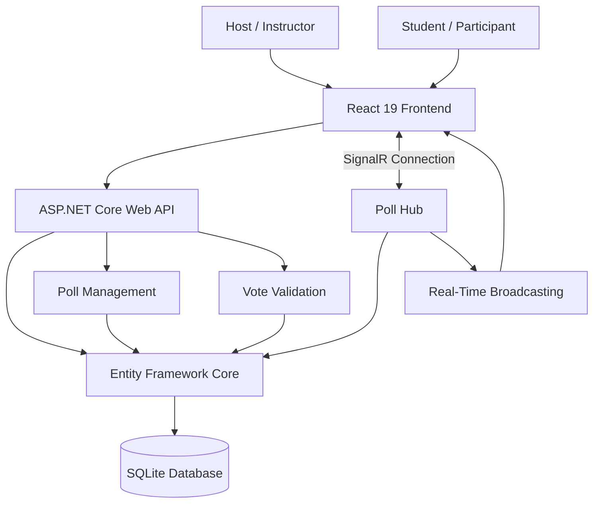

# 🗳️ LivePoll — Real-Time Polling Platform

<p align="center">
  <strong>Ask. Vote. Connect. In Real Time.</strong>
  <br/>
  A real-time polling and audience engagement platform powered by ASP.NET Core, React, SignalR, and SQLite.
</p>

<p align="center">
  
  
  
  
  
</p>

---

## ⚡ Overview

**LivePoll** is a real-time polling platform designed for classrooms, workshops, presentations, enterprise surveys, and interactive events.

Hosts can create polls, control voting sessions, and monitor participant responses through a live dashboard. Participants can join a session and submit their votes while results synchronize instantly across connected clients.

No refreshing. No waiting. Just real-time interaction.

## ✨ Features

### 👨‍🏫 Host / Instructor
- Create polls with 2–10 answer options.
- Generate unique poll access codes.
- Control poll lifecycle: Draft → Open → Closed.
- Open and close voting sessions.
- Monitor live voting statistics.
- View participant voting activity.
- Access a voter audit roster with timestamps.
- Track poll status and submission history.

### 🙋 Student / Participant
- Join polls using a unique access code.
- View available poll questions and options.
- Submit votes instantly.
- Receive real-time poll updates.
- Get duplicate-vote protection.
- View updated results when available.

### ⚡ Real-Time Infrastructure
- ASP.NET Core SignalR integration.
- WebSocket-based real-time communication when supported.
- SignalR groups for poll-specific broadcasting.
- Instant vote tally synchronization.
- Live poll lifecycle notifications.
- Automatic reconnection support through the SignalR client configuration.

### 🔐 Data Integrity
- SQLite persistence.
- Entity Framework Core.
- Composite unique index on `(PollId, VoterId)`.
- Database-enforced duplicate vote prevention.
- HTTP `409 Conflict` for duplicate submissions.
- Persistent poll and session state.

---

## 🛠️ Tech Stack

| Layer | Technology |
|---|---|
| Backend | ASP.NET Core Web API (.NET 10) |
| Language | C# |
| ORM | Entity Framework Core |
| Database | SQLite |
| Real-time | ASP.NET Core SignalR |
| Frontend | React 19 |
| Build Tool | Vite |
| Frontend Language | TypeScript |
| Real-time Client | @microsoft/signalr |
| Authentication | Host / Participant role profiles |
| Client Persistence | localStorage |

---

## 🏗️ Architecture



### 🔄 How It Works

1. **Poll Creation:** The host creates a poll through the React dashboard.
2. **Persistence:** The ASP.NET Core API stores poll information in SQLite through Entity Framework Core.
3. **Session Activation:** The host opens the poll, triggering a SignalR notification.
4. **Participant Voting:** Participants submit their votes using the poll access code.
5. **Validation:** The backend checks whether the participant has already voted.
6. **Database Integrity:** A composite unique constraint prevents duplicate votes.
7. **Broadcasting:** SignalR broadcasts updated results to clients connected to the relevant poll group.
8. **Audit Logging:** The host can retrieve the voting roster and submission timestamps.

---

## 🎨 Design System

LivePoll uses a dark teal and terracotta color palette to create a modern, focused dashboard experience.

| Color | Hex | Usage |
|---|---|---|
| Obsidian Blue-Black | `#0a0f14` | Application background |
| Dark Emerald | `#0f3d3e` | Cards and panels |
| Deep Teal | `#2e6f73` | Borders and secondary elements |
| Seafoam Teal | `#7FB3B8` | Progress bars and success states |
| Soft Cream | `#EADCC8` | Typography |
| Terracotta | `#c6601f` | Primary actions and active states |

---

## 📂 Project Structure

```text
PollingApp/
│
├── LivePoll.Api/
│   ├── Controllers/
│   │   └── PollsController.cs
│   │
│   ├── Hubs/
│   │   └── PollHub.cs
│   │
│   ├── Models/
│   │   ├── Poll.cs
│   │   ├── PollOption.cs
│   │   └── Vote.cs
│   │
│   ├── Data/
│   │   └── ApplicationDbContext.cs
│   │
│   ├── Services/
│   │
│   ├── Migrations/
│   │
│   ├── Program.cs
│   └── appsettings.json
│
├── LivePoll.Client/
│   ├── public/
│   │
│   ├── src/
│   │   ├── components/
│   │   ├── pages/
│   │   ├── services/
│   │   ├── hooks/
│   │   ├── types/
│   │   ├── App.tsx
│   │   └── main.tsx
│   │
│   ├── package.json
│   └── vite.config.ts
│
└── README.md
```

*Folder names are illustrative; adjust them to match the actual repository.*

---

## 🚀 Getting Started

### Prerequisites

Make sure you have installed:

- [.NET 10 SDK](https://dotnet.microsoft.com/download/dotnet/10.0)
- [Node.js](https://nodejs.org/) (compatible with your Vite version)
- npm
- Git

### 1. Clone the Repository

```bash
git clone https://github.com/YOUR_USERNAME/PollingApp.git

cd PollingApp
```

### 2. Start the Backend

```bash
cd LivePoll.Api

dotnet restore

dotnet run
```

Backend API:

```text
http://localhost:5255
```

### 3. Start the Frontend

Open another terminal:

```bash
cd PollingApp/LivePoll.Client

npm install

npm run dev
```

Frontend:

```text
http://localhost:5173
```

### 4. Connect the Frontend and Backend

Ensure your frontend API configuration points to the backend:

```typescript
const API_BASE_URL = "http://localhost:5255";
```

Configure the SignalR hub URL:

```typescript
const connection = new HubConnectionBuilder()
  .withUrl(`${API_BASE_URL}/hubs/polls`)
  .withAutomaticReconnect()
  .build();
```

Make sure backend CORS policies allow the frontend origin.

---

## 📡 API Documentation

| Method | Endpoint | Description |
|---|---|---|
| POST | `/api/polls` | Create a new poll |
| GET | `/api/polls/{code}` | Retrieve poll details and vote tallies |
| POST | `/api/polls/{code}/open` | Open a poll |
| POST | `/api/polls/{code}/close` | Close a poll |
| POST | `/api/polls/{code}/votes` | Submit a vote |
| GET | `/api/polls/{code}/votes` | Retrieve the host voting roster |

### Example: Create a Poll

```http
POST /api/polls
Content-Type: application/json
```

```json
{
  "question": "Which programming language do you prefer?",
  "options": [
    "Python",
    "JavaScript",
    "C#",
    "Java"
  ]
}
```

### Example: Submit a Vote

```http
POST /api/polls/ABC123/votes
Content-Type: application/json
```

```json
{
  "voterId": "participant-001",
  "optionId": 2
}
```

*Request property names and response schemas should be adjusted to match the actual API DTOs.*

### HTTP Response Codes

| Status | Meaning |
|---|---|
| 200 | Request successful |
| 201 | Resource created, if returned by the endpoint |
| 400 | Invalid request |
| 404 | Poll or option not found |
| 409 | Duplicate vote |
| 500 | Internal server error |

---

## 📡 SignalR Events

SignalR hub endpoint:

```text
/hubs/polls
```

Suggested event responsibilities:

| Event | Purpose |
|---|---|
| PollOpened | Notify participants that voting has started |
| PollClosed | Notify participants that voting has ended |
| VoteUpdated | Broadcast updated vote totals |
| PollUpdated | Synchronize poll state changes |

SignalR groups allow clients to subscribe to updates for a particular poll rather than receiving unrelated session notifications.

---

## 🛡️ Duplicate Vote Protection

One of LivePoll's important integrity features is database-level duplicate vote prevention.

The database uses a composite unique index:

```csharp
modelBuilder.Entity<Vote>()
    .HasIndex(v => new { v.PollId, v.VoterId })
    .IsUnique();
```

This ensures that the same voter identity cannot submit multiple votes for the same poll.

The backend should also handle unique-constraint violations and return:

```http
409 Conflict
```

**Why this matters:**

- Prevents duplicate submissions.
- Protects against concurrent requests.
- Keeps vote counts consistent.
- Enforces integrity at the database level.

---

## 📸 Screenshots

Add screenshots of your actual application here.

| Dashboard | Poll Creation |
|---|---|
| `` | `` |

| Participant Voting | Live Results |
|---|---|
| `` | `` |

---

## 🧪 Testing

Run backend tests:

```bash
dotnet test
```

Run frontend checks (depending on configured scripts):

```bash
npm run lint
npm run build
```

Important scenarios to test:

- Poll creation with valid options.
- Poll creation with fewer than 2 or more than 10 options.
- Opening and closing polls.
- Voting while a poll is closed.
- Duplicate vote attempts.
- Concurrent vote submissions.
- SignalR synchronization between multiple clients.
- Persistence after backend restart.

---

## 🔮 Future Improvements

- [ ] JWT-based authentication.
- [ ] Persistent user accounts and role management.
- [ ] QR-code poll joining.
- [ ] Anonymous polling mode.
- [ ] Advanced analytics and visualizations.
- [ ] Export voting results to CSV/PDF.
- [ ] Multiple active polls per host.
- [ ] Scheduled polls.
- [ ] Docker containerization.
- [ ] Unit and integration test coverage.
- [ ] Production deployment with HTTPS.

---

## 💡 Engineering Concepts Demonstrated

LivePoll is more than a CRUD application. It demonstrates several practical software engineering concepts:

- RESTful API design.
- Real-time event-driven architecture.
- WebSocket communication through SignalR.
- Database normalization and relational modeling.
- Composite unique indexes.
- Concurrency and data integrity.
- Client-server synchronization.
- State management.
- Role-based application workflows.
- Full-stack development with .NET and React.

---

## 🤝 Contributing

Contributions, suggestions, and feature improvements are welcome!

1. Fork the repository.
2. Create a feature branch.
3. Commit your changes.
4. Push your branch.
5. Open a Pull Request.

```bash
git checkout -b feature/your-feature

git add .

git commit -m "feat: add your feature"

git push origin feature/your-feature
```

---

## 📜 License

This project is available under the MIT License. Add a `LICENSE` file to the repository if you intend to distribute it under that license.

---

<p align="center">
  <strong>Built with ☕, C#, TypeScript, and a passion for real-time systems.</strong>
  <br/>
  <sub>Less waiting. More interacting. That's LivePoll.</sub>
</p>
