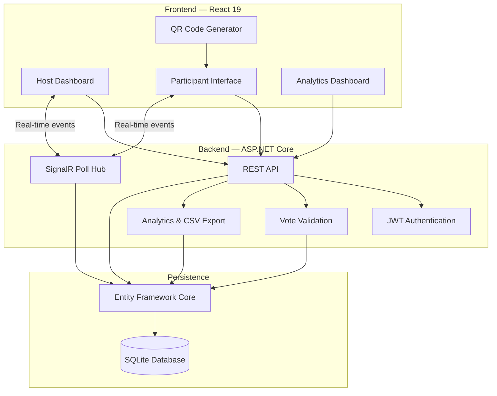
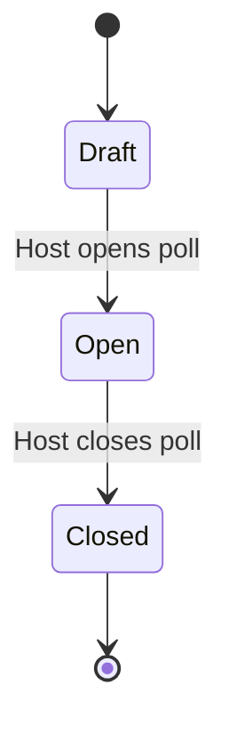
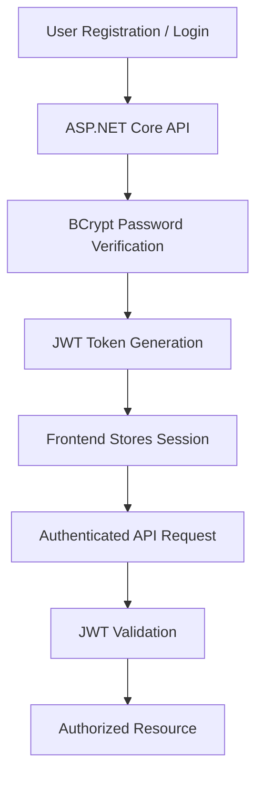
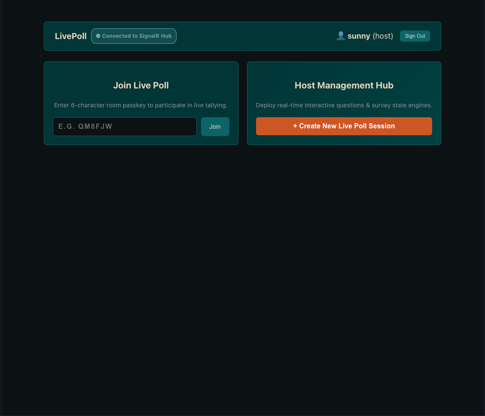
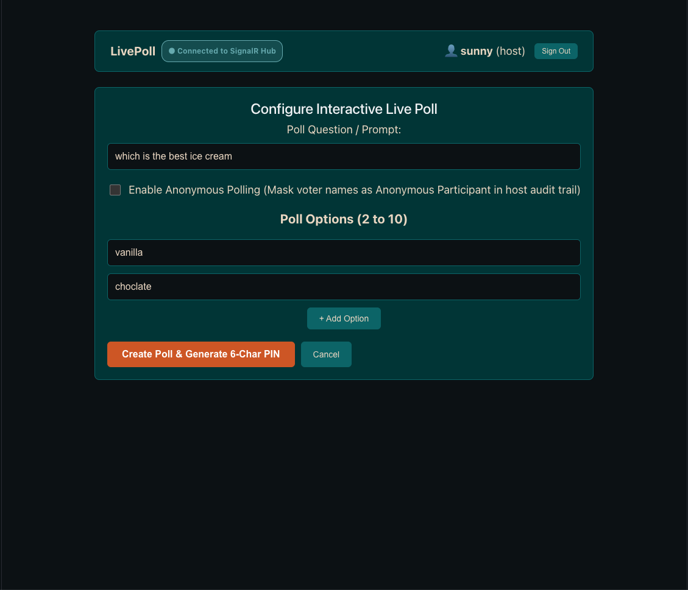

# 🗳️ LivePoll — Real-Time Polling Platform

<p align="center">
  <strong>Ask. Vote. Connect. In Real Time.</strong>
  <br/>
  A real-time polling and audience engagement platform powered by ASP.NET Core, React, SignalR, and SQLite.
</p>

<p align="center">
  
  
  
  
  
</p>

<p align="center">
  
  
  
</p>

---

## ⚡ Overview

**LivePoll** is a real-time polling and audience engagement platform designed for classrooms, workshops, presentations, enterprise surveys, and interactive events.

The platform allows hosts and instructors to create interactive polls, manage live voting sessions, and monitor participant responses through a real-time dashboard.

Participants can join using unique six-character access codes or QR codes and submit their votes instantly.

With ASP.NET Core SignalR, poll updates are synchronized across connected clients without requiring page refreshes.

**No refreshing. No waiting. Just real-time interaction.**

## ✨ Features

### 👨‍🏫 Host / Instructor Dashboard

- Create polls with 2–10 answer options.
- Generate unique six-character poll access codes.
- Generate QR codes for instant room joining.
- Enable anonymous polling mode.
- Control poll lifecycle: `Draft → Open → Closed`.
- Monitor live voting statistics.
- Visualize vote distributions and percentages.
- Access participant voting activity and timestamps.
- Export poll analytics and voting summaries as CSV.
- Manage poll sessions from a centralized dashboard.

### 🙋 Student / Participant Experience

- Join polls using access codes.
- Join sessions through QR code links.
- View available poll questions and answer options.
- Submit votes with client-side and server-side validation.
- Receive instant voting status updates.
- Benefit from duplicate-vote protection.
- Participate in anonymous polling sessions.

### ⚡ Real-Time Infrastructure

- ASP.NET Core SignalR integration.
- WebSocket communication with supported transport fallback.
- Poll-specific SignalR group management.
- Instant vote tally synchronization.
- Live poll lifecycle notifications.
- Automatic reconnection support.
- Event-driven client updates.

### 🔐 Authentication & Data Integrity

- JWT Bearer authentication.
- User registration and login.
- BCrypt password hashing.
- Host and participant role profiles.
- SQLite database persistence.
- Entity Framework Core ORM.
- Composite unique index on `(PollId, VoterId)`.
- Database-enforced duplicate vote prevention.
- HTTP `409 Conflict` handling.
- Poll-specific access control.

### 📊 Analytics & Reporting

- Live vote counts.
- Percentage distribution for each option.
- Leading option identification.
- Participant submission timestamps.
- Host voting audit roster.
- CSV report downloads.

---

## 🛠️ Tech Stack

| Layer | Technology |
|---|---|
| Backend Framework | ASP.NET Core Web API (.NET 10) |
| Backend Language | C# |
| ORM | Entity Framework Core |
| Database | SQLite |
| Real-Time Engine | ASP.NET Core SignalR |
| Authentication | JWT Bearer |
| Password Security | BCrypt |
| Frontend | React 19 |
| Build Tool | Vite |
| Frontend Language | TypeScript |
| Real-Time Client | @microsoft/signalr |
| QR Code Generation | qrcode.react |
| Client Persistence | localStorage |
| Analytics Export | CSV |

---

## 🏗️ System Architecture

LivePoll follows a client-server architecture with real-time event broadcasting.

### High-Level Architecture



### 🔄 Poll Lifecycle



### How Voting Works

1. **Poll Creation:** The host creates a poll through the dashboard.
2. **Database Persistence:** Poll information is saved through Entity Framework Core.
3. **Room Generation:** The application generates a unique six-character access code and QR joining link.
4. **Session Activation:** The host opens the poll.
5. **Real-Time Notification:** SignalR broadcasts the session state to the relevant poll group.
6. **Participant Voting:** Participants submit their selected options.
7. **Vote Validation:** The backend validates the poll state, option, and voter identity.
8. **Duplicate Protection:** A database unique constraint prevents multiple votes from the same voter in one poll.
9. **Live Broadcasting:** Updated voting results are broadcast to connected clients.
10. **Analytics:** The host can inspect results and download CSV reports.

---

## 🔐 Authentication & Security

LivePoll uses JWT Bearer authentication to manage authenticated users and protect restricted API operations.

### Authentication Flow



### Security Considerations

- Passwords should never be stored as plaintext.
- JWT signing keys should be stored in environment variables or secure configuration.
- Host-only operations must enforce server-side authorization.
- Anonymous polling must hide participant identity from public responses.
- Internal voter identifiers should remain available for duplicate-vote enforcement.
- Poll access codes should be generated with sufficient randomness.
- SignalR connections should enforce authentication and poll-specific authorization where appropriate.

---

## 🛡️ Duplicate Vote Protection

One of LivePoll's core integrity features is database-level duplicate vote prevention.

The application uses a composite unique index:

```csharp
modelBuilder.Entity<Vote>()
    .HasIndex(v => new { v.PollId, v.VoterId })
    .IsUnique();
```

This ensures that one voter identity cannot submit multiple votes for the same poll.

### Why Database-Level Protection?

- Prevents duplicate submissions.
- Protects against concurrent requests.
- Reduces dependence on frontend validation.
- Maintains voting integrity.
- Provides a reliable enforcement mechanism.

Duplicate submissions should return:

```http
409 Conflict
```

---

## 📡 Real-Time Communication

SignalR hub endpoint:

```text
/hubs/polls
```

LivePoll uses SignalR groups to organize participants by poll session.

### Suggested Event Structure

| Event | Responsibility |
|---|---|
| `PollOpened` | Notify participants that voting has started |
| `PollClosed` | Notify participants that voting has ended |
| `VoteUpdated` | Broadcast updated vote totals |
| `PollUpdated` | Synchronize poll changes |

### Example SignalR Client

```typescript
import {
  HubConnectionBuilder,
  HubConnectionState,
} from "@microsoft/signalr";

const connection = new HubConnectionBuilder()
  .withUrl("http://localhost:5255/hubs/polls")
  .withAutomaticReconnect()
  .build();

await connection.start();

if (connection.state === HubConnectionState.Connected) {
  console.log("Connected to LivePoll SignalR Hub");
}
```

*Adapt the URL, authentication configuration, and event names to the actual backend implementation.*

---

## 📊 Analytics & CSV Export

LivePoll provides voting analytics to help hosts understand participant responses.

### Analytics Capabilities

- Total number of votes.
- Individual option vote counts.
- Percentage distribution.
- Leading answer identification.
- Participant voting activity.
- CSV summary exports.

### Example CSV Output

```csv
PollCode,Question,Option,Votes,Percentage
ABC123,Preferred Language,Python,15,50
ABC123,Preferred Language,JavaScript,8,26.67
ABC123,Preferred Language,CSharp,7,23.33
```

The export should respect anonymous polling settings and avoid exposing personally identifying participant information in anonymous reports.

---

## 🎨 Design System

LivePoll uses a custom dark teal and terracotta palette.

| Color | Hex | Usage |
|---|---|---|
| Obsidian Blue-Black | `#0a0f14` | Application background |
| Dark Emerald | `#0f3d3e` | Cards and panels |
| Deep Teal | `#2e6f73` | Borders and dividers |
| Seafoam Teal | `#7FB3B8` | Progress bars and success states |
| Soft Cream | `#EADCC8` | Typography |
| Terracotta | `#c6601f` | Primary actions and active states |

---

## 📂 Project Structure

```text
PollingApp/
│
├── LivePoll.Api/
│   │
│   ├── Controllers/
│   │   ├── AuthController.cs
│   │   └── PollsController.cs
│   │
│   ├── Hubs/
│   │   └── PollHub.cs
│   │
│   ├── Models/
│   │   ├── Poll.cs
│   │   ├── PollOption.cs
│   │   ├── Vote.cs
│   │   └── User.cs
│   │
│   ├── DTOs/
│   │   └── PollDtos.cs
│   │
│   ├── Data/
│   │   └── AppDbContext.cs
│   │
│   ├── Services/
│   │
│   ├── Program.cs
│   └── appsettings.json
│
├── LivePoll.Client/
│   │
│   ├── public/
│   │
│   ├── src/
│   │   ├── components/
│   │   ├── pages/
│   │   ├── services/
│   │   │   └── api.ts
│   │   ├── hooks/
│   │   ├── context/
│   │   ├── types/
│   │   │   └── poll.ts
│   │   ├── App.tsx
│   │   └── main.tsx
│   │
│   ├── package.json
│   └── vite.config.ts
│
├── docs/
│   └── screenshots/
│
└── README.md
```

*The structure is illustrative. Update it to reflect your actual repository.*

---

## 🚀 Getting Started

### Prerequisites

Install the following tools:

- [.NET 10 SDK](https://dotnet.microsoft.com/download/dotnet/10.0)
- [Node.js](https://nodejs.org/)
- npm
- Git

### 1. Clone the Repository

```bash
git clone https://github.com/iamSunnyrohit/PollingApp.git

cd PollingApp
```

### 2. Configure Backend Environment

Configure your JWT signing key and other application settings using environment variables or .NET user secrets.

For local development, you can use:

```bash
cd LivePoll.Api

dotnet user-secrets init

dotnet user-secrets set "Jwt:Key" "YOUR_LONG_RANDOM_DEVELOPMENT_SECRET"
```

Do not commit real secrets to GitHub.

### 3. Start the Backend API

```bash
cd LivePoll.Api

dotnet restore

dotnet run
```

Backend:

```text
http://localhost:5255
```

### 4. Start the Frontend Client

Open a second terminal:

```bash
cd PollingApp/LivePoll.Client

npm install

npm run dev
```

Frontend:

```text
http://localhost:5173
```

### 5. Configure Frontend API URL

Ensure your frontend API service uses the backend address:

```typescript
const API_BASE_URL = "http://localhost:5255";
```

For a Vite environment configuration, you can use:

```env
VITE_API_BASE_URL=http://localhost:5255
```

Then access it through:

```typescript
const API_BASE_URL = import.meta.env.VITE_API_BASE_URL;
```

Ensure the backend CORS policy allows the frontend origin.

---

## 📡 API Documentation

### Authentication

| Method | Endpoint | Description |
|---|---|---|
| POST | `/api/auth/register` | Register a user |
| POST | `/api/auth/login` | Authenticate and issue JWT |

### Poll Management

| Method | Endpoint | Description |
|---|---|---|
| POST | `/api/polls` | Create a new poll |
| GET | `/api/polls/{code}` | Retrieve poll metadata and live tallies |
| POST | `/api/polls/{code}/open` | Open voting session |
| POST | `/api/polls/{code}/close` | Close voting session |

### Voting

| Method | Endpoint | Description |
|---|---|---|
| POST | `/api/polls/{code}/votes` | Submit a vote |
| GET | `/api/polls/{code}/votes` | Retrieve host voting roster |

### Analytics

| Method | Endpoint | Description |
|---|---|---|
| GET | `/api/polls/{code}/analytics` | Retrieve poll analytics |
| GET | `/api/polls/{code}/export/csv` | Download CSV report |

*Confirm all endpoint paths and authorization requirements against your implemented controllers.*

---

## 🧪 Testing

Run backend tests:

```bash
dotnet test
```

Run frontend checks:

```bash
npm run lint

npm run build
```

### Important Test Scenarios

- [ ] User registration and login.
- [ ] Invalid password handling.
- [ ] JWT authorization.
- [ ] Poll creation with valid options.
- [ ] Poll creation with fewer than 2 or more than 10 options.
- [ ] Unique six-character room code generation.
- [ ] QR code joining.
- [ ] Opening and closing voting sessions.
- [ ] Voting while a poll is closed.
- [ ] Duplicate vote prevention.
- [ ] Concurrent voting requests.
- [ ] Anonymous polling privacy.
- [ ] SignalR synchronization across clients.
- [ ] Analytics calculation accuracy.
- [ ] CSV export correctness.
- [ ] Persistence after backend restart.

---

## 📸 Application Screenshots

### 🏠 Host Dashboard



### 📝 Poll Creation



## 🔮 Future Roadmap

- [ ] Email verification.
- [ ] Password reset functionality.
- [ ] Advanced role and permission management.
- [ ] Scheduled polling sessions.
- [ ] Multiple active polls per host.
- [ ] PDF analytics reports.
- [ ] Advanced data visualizations.
- [ ] Poll templates.
- [ ] Docker containerization.
- [ ] Automated integration testing.
- [ ] Cloud deployment.
- [ ] Production monitoring and logging.

---

## 🧠 Engineering Concepts Demonstrated

LivePoll demonstrates practical software engineering concepts:

- RESTful API architecture.
- Real-time event-driven communication.
- WebSocket communication and transport negotiation.
- JWT authentication and authorization.
- Password hashing.
- Relational database design.
- Entity Framework Core.
- Composite unique constraints.
- Concurrent request handling.
- Data integrity and validation.
- Real-time frontend synchronization.
- CSV data generation and export.
- Full-stack application development.

---

## 🤝 Contributing

Contributions, suggestions, and improvements are welcome!

1. Fork the repository.
2. Create a feature branch.
3. Commit your changes.
4. Push your branch.
5. Open a Pull Request.

```bash
git checkout -b feature/your-feature

git add .

git commit -m "feat: add your feature"

git push origin feature/your-feature
```

---

## 📜 License

This project is intended to use the MIT License. Add a `LICENSE` file containing the appropriate MIT license text before publishing it under that license.

---

<p align="center">
  <strong>Built with ☕, C#, TypeScript, and a passion for real-time systems.</strong>
  <br/>
  <sub>Less waiting. More interacting. That's LivePoll.</sub>
</p>